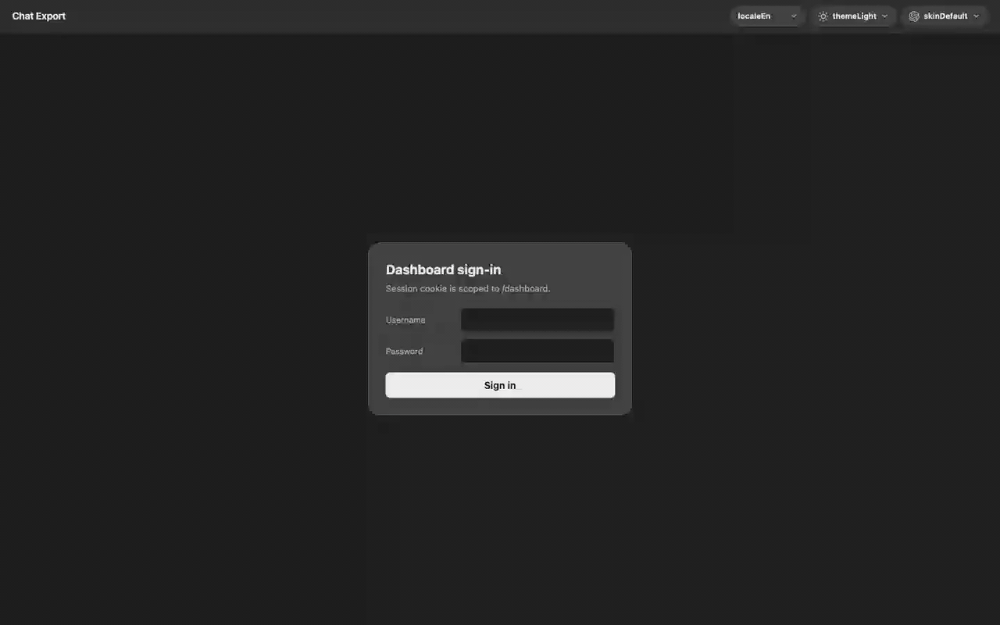

[English](README.md) | [Русский](README.ru.md) · [](https://www.donationalerts.com/r/svwergio_mel) · [](https://glama.ai/mcp/servers/svergio/chat-export-server) · [](https://mcpservers.org/ru/)

# chat-export-dashboard

<p align="center">
  
</p>

**Operator dashboard** for [chat-export-server](https://github.com/svergio/chat-export-server). Monitor browsers, job queues, chat cache, logs, and MCP tokens — served as static React at `http://127.0.0.1:8765/dashboard/` when the server embeds this repo as the `dashboard/` submodule.

Works with the [Chat Export extension](https://github.com/svergio/chat-export-extension) bridge; no cloud account required.

## Standalone

The dashboard is an **optional** operator UI for `chat-export-server`. The Chat Export product does not require Cursor, Chrome DevTools MCP, Open WebUI, or vendored local-agent code — only the extension + server (+ this UI if you want it).

## The problem

MCP and CLI are powerful but opaque when jobs stall, a browser drops offline, or you need to copy logs. The dashboard gives a **local-only** control plane with the same security boundary as the server.

## What you get

| Area | What you see |
|------|----------------|
| Overview | Health, MCP activity, resource snapshot |
| Browsers | Connected profiles, bind hints, platform tabs |
| Queues | Job pipeline by status and browser |
| Cache | Temp chat cache entries |
| Logs | Server log stream (live/pause, filters) |
| Settings | Language (EN/RU), skins (8 providers), MCP token helpers |

Session auth uses cookie `ce_dash_sid`; APIs under `/dashboard/api` on the server host.

## Architecture

The dashboard is a **static React** build (`public/`) embedded in [chat-export-server](https://github.com/svergio/chat-export-server) at `/dashboard/`. Your operator browser loads UI assets from the same origin as the server; authenticated calls hit `/dashboard/api`, which reads browser hub state, job queues, cache, and logs from the core process and ultimately drives the Chrome **extension WebSocket** bridge — no separate cloud backend.

Build with `npm ci && npm run build`, sync into the server’s `dashboard/` submodule, then `chat-export-server start`. Optional **nginx split image** proxies API, MCP, and WebSocket to `SERVER_UPSTREAM` (Colima-friendly). Diagrams: **[Wiki — Architecture](https://github.com/svergio/chat-export-extension/wiki/Architecture)** (dashboard section). Security and auth: [Dashboard and security](https://github.com/svergio/chat-export-extension/wiki/Dashboard-and-Security) · [Native / K8s deploy](https://github.com/svergio/chat-export-extension/wiki/Native-and-Kubernetes-Deployment).

## Quick start (3 steps)

1. Install [chat-export-server](https://github.com/svergio/chat-export-server) and init submodule: `git submodule update --init dashboard`.
2. In this repo: `npm ci && npm run build` → output in `public/`; server copies or serves that tree.
3. `chat-export-server start`, open `http://127.0.0.1:8765/dashboard/`, sign in with dashboard password from server config.

Wiki: [Dashboard and security](https://github.com/svergio/chat-export-extension/wiki).

## Build

```bash
npm ci
npm run build
```

Produces `public/index.html`, `public/assets/*`, `public/locales/`, `public/styles.css`, `public/skins.css`.

## Docker (optional split front)

[`Dockerfile`](Dockerfile) builds static assets with Node 22, then serves them from **nginx** and reverse-proxies `/dashboard/api`, `/mcp`, `/ws`, `/ext`, `/enroll`, and `/health` to `SERVER_UPSTREAM` (default `server:8765`). Use with Colima (`docker --context colima …`) and the maintainer `docker-compose.yml` that pairs this image with `chat-export-server` — not Docker Desktop.

## Develop

```bash
npm run dev
```

Vite proxies `/dashboard/api` to the running server (adjust `vite.config.ts` if port differs).

## Stack

React 19, TypeScript, Vite. Eight provider skins (ChatGPT, Grok, Grok-X, Copilot, Claude, Qwen, DeepSeek, Perplexity) with light / dark / auto.

## Security

- Reachable only where you expose the server — keep **loopback** unless you add TLS and auth hardening.
- Dashboard login is separate from MCP Bearer keys; rotate both if leaked.
- See [SECURITY.md](SECURITY.md) and server threat model.

## Related repositories

| Repo | Role |
|------|------|
| [chat-export-extension](https://github.com/svergio/chat-export-extension) | Browser bridge |
| [chat-export-server](https://github.com/svergio/chat-export-server) | Host + API |
| [chat-export-dashboard](https://github.com/svergio/chat-export-dashboard) (this) | Static UI |
| [Wiki](https://github.com/svergio/chat-export-extension/wiki) | Operator docs |

## Support the project

- **Tip (fiat):** [DonationAlerts — svwergio_mel](https://www.donationalerts.com/r/svwergio_mel)

Tips are voluntary.

## Tests

```bash
npm test
```

CI (`.github/workflows/ci.yml`) runs `npm test` (locale + legal string parity), build, and audit on branches **`test`** and **`main`**.

## Contributing

See [CONTRIBUTING.md](./CONTRIBUTING.md) (locales, `LegalFooter`, embed sync into the server) and extension [CONTRIBUTING](https://github.com/svergio/chat-export-extension/blob/main/CONTRIBUTING.md) for cross-repo i18n.

## Dependencies

**Runtime:** React 19 + react-dom (Vite/TypeScript are dev-only; production is static `public/`).

**Product graph:** built into [chat-export-server](https://github.com/svergio/chat-export-server) at `/dashboard/`; API calls stay on the same origin as the server. The [extension](https://github.com/svergio/chat-export-extension) bridge does not add npm deps here. Shared wire types: server `packages/protocol/`.

Docker (optional): Node builder + **nginx:1.27-alpine** serving compiled assets. See [THIRD_PARTY_NOTICES.md](./THIRD_PARTY_NOTICES.md); refresh with `npm run licenses`.

**Not required:** Cursor, Open WebUI, BibLLMsteak, Bonsai-27B, NodeRed — not runtime dependencies.

## License

See [LICENSE](LICENSE).
