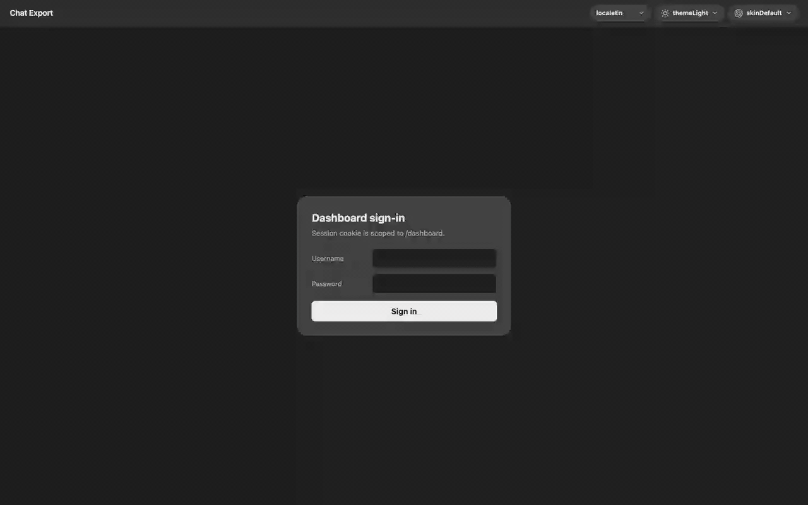
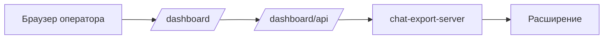

[English](README.md) | [Русский](README.ru.md) · [](https://www.donationalerts.com/r/svwergio_mel)

# chat-export-dashboard

<p align="center">
  
</p>

**Дашборд оператора** для [chat-export-server](https://github.com/svergio/chat-export-server). Браузеры, очереди задач, кеш чатов, логи и MCP-токены — статический React на `http://127.0.0.1:8765/dashboard/`, когда сервер подключает этот репозиторий как submodule `dashboard/`.

Работает с [расширением Chat Export](https://github.com/svergio/chat-export-extension); облачный аккаунт не нужен.

## Зачем

MCP и CLI неудобны, когда задача зависла, браузер отвалился или нужно скопировать лог. Дашборд — **локальная** панель с той же границей безопасности, что и сервер.

## Возможности

| Раздел | Содержимое |
|--------|------------|
| Обзор | Состояние, MCP, ресурсы |
| Браузеры | Профили, подсказки bind, вкладки |
| Очереди | Пайплайн задач |
| Кеш | Временный кеш чатов |
| Логи | Поток логов сервера |
| Настройки | EN/RU, 8 скинов провайдеров, MCP |

Сессия: cookie `ce_dash_sid`; API: `/dashboard/api`.



## Быстрый старт (3 шага)

1. [chat-export-server](https://github.com/svergio/chat-export-server), `git submodule update --init dashboard`.
2. Здесь: `npm ci && npm run build` → `public/`.
3. `chat-export-server start`, откройте `http://127.0.0.1:8765/dashboard/`, войдите паролем дашборда.

## Сборка и разработка

```bash
npm ci && npm run build
npm run dev   # proxy /dashboard/api на сервер
```

React 19, TypeScript, Vite; восемь скинов (ChatGPT, Grok, Grok-X, Copilot, Claude, Qwen, DeepSeek, Perplexity).

## Docker (опциональный фронт)

[`Dockerfile`](Dockerfile): сборка в Node 22, раздача статики через **nginx**, прокси `/dashboard/api`, `/mcp`, `/ws`, `/ext`, `/enroll`, `/health` на `SERVER_UPSTREAM` (по умолчанию `server:8765`). Запуск через Colima (`docker --context colima …`) вместе с `chat-export-server` в `docker-compose.yml` дерева Chat Export.

## Безопасность

- Доступен там, где слушает сервер — держите **loopback**, если не настроили TLS и усиленную аутентификацию.
- Пароль дашборда ≠ MCP Bearer.
- [SECURITY.md](SECURITY.md).

## Репозитории

| Репозиторий | Роль |
|-------------|------|
| [extension](https://github.com/svergio/chat-export-extension) | Мост |
| [server](https://github.com/svergio/chat-export-server) | Хост + API |
| [dashboard](https://github.com/svergio/chat-export-dashboard) (этот) | UI |
| [Wiki](https://github.com/svergio/chat-export-extension/wiki) | Документация |

## Поддержка проекта

- [DonationAlerts — svwergio_mel](https://www.donationalerts.com/r/svwergio_mel)

## Участие в разработке

Скины и локали дашборда: [CONTRIBUTING.md](https://github.com/svergio/chat-export-extension/blob/main/CONTRIBUTING.md).

## Лицензия

[LICENSE](LICENSE).
